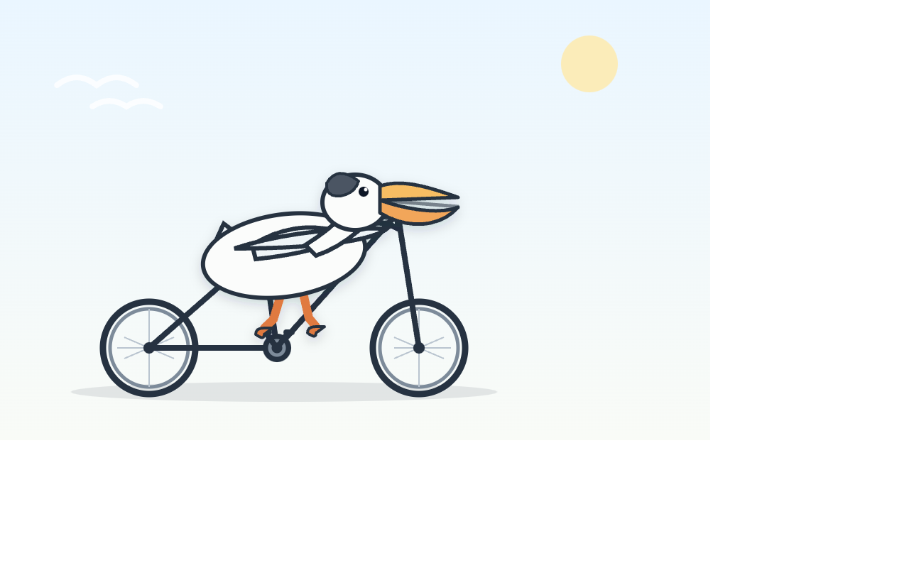
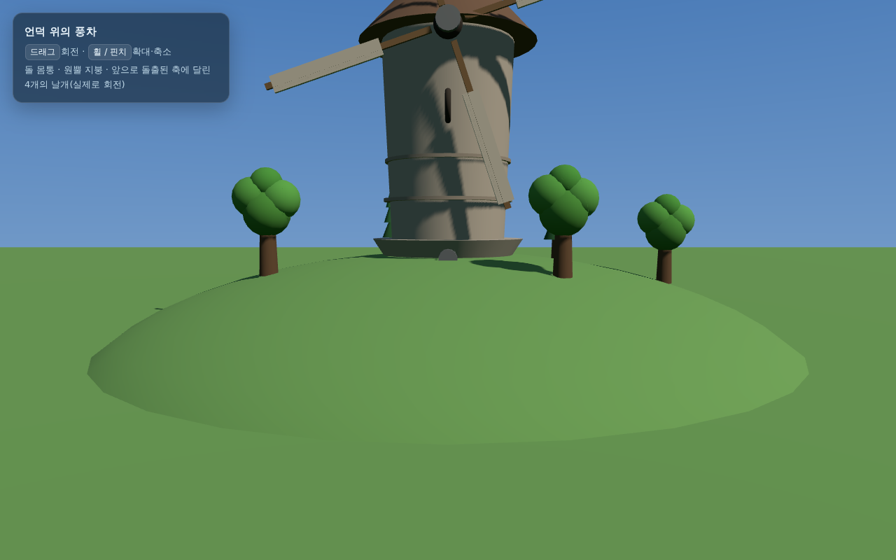
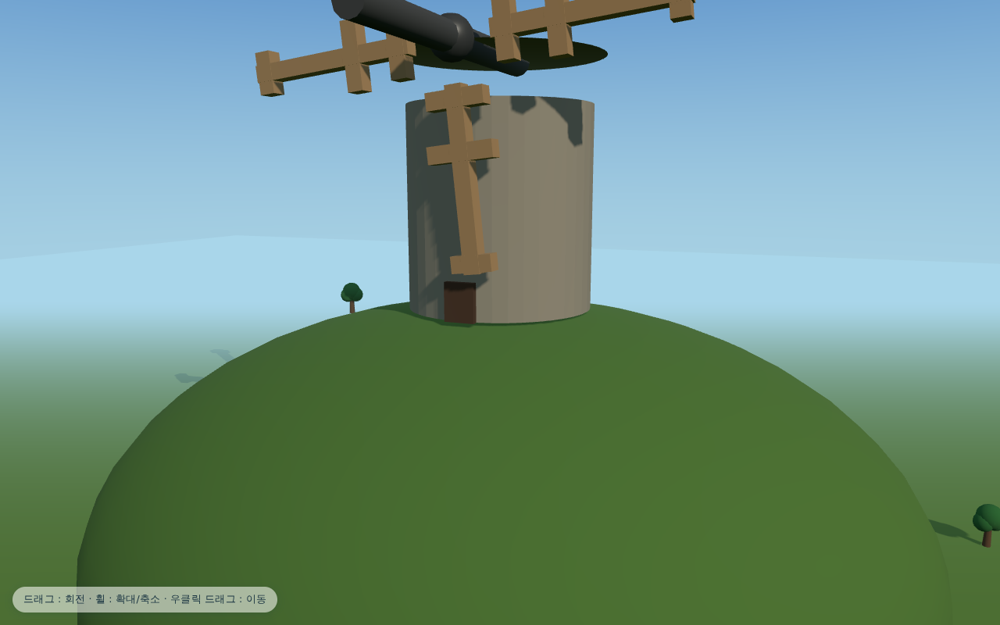
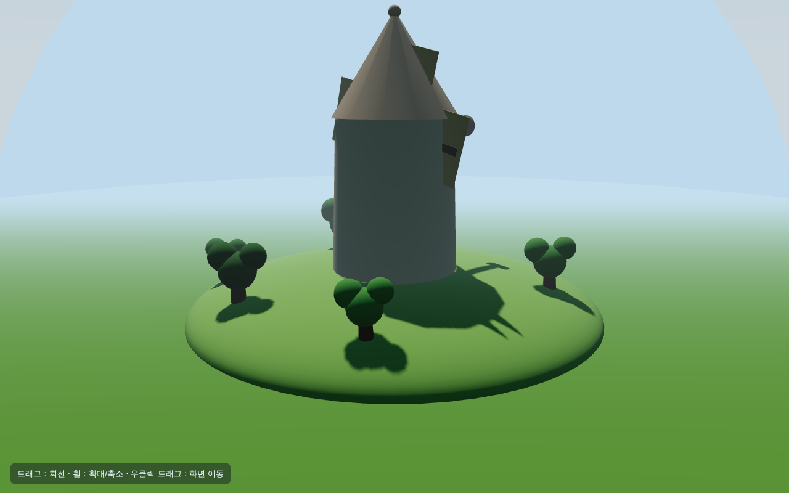

# K-EXAONE 2.5 간단 성능 테스트

LG AI연구원 [EXAONE API](https://docs.exaone.ai/ko/docs/k-exaone-2.5)의 `k-exaone_v2.5` 모델을 두 가지 생성 과제로, `reasoning_effort`(`max` / `high` / `low`)를 바꿔가며 돌려본 결과입니다.

👉 **웹에서 비교해 보기: https://yalex-kim.github.io/k-exaone-bench/** (평가표 · 생성 시간 · 결과물 · 3D 장면 실행 · 추론 전문)

- 테스트 일자: 2026-11-10
- 호출 방식: `POST https://api.exaone.ai/v1/chat/completions`, `stream: true`, `max_tokens: 64000`, 그 외 파라미터는 기본값
- 과제당 1회씩만 실행한 결과라 통계적 의미는 없습니다. 인상 비교용입니다.

## 과제

1. **풍차 3D** — Three.js 단일 HTML로 언덕 위 풍차 장면 만들기 ([프롬프트](prompts/windmill.txt))
2. **자전거 타는 펠리컨** — Simon Willison의 유명한 `Generate an SVG of a pelican riding a bicycle` ([프롬프트](prompts/pelican.txt))

## 결과 요약

### 🚲 자전거 타는 펠리컨 (SVG)

| effort | 소요 시간 | 출력 토큰 (추론 비율) | 결과 |
|---|---|---|---|
| max | 30분에 끊김 | – | ❌ 그림 없음. SVG가 아니라 HTML 페이지를 쓰기 시작하다 서버 쪽 30분 제한으로 끊김 |
| high | **10분** | 22,210 (87%) | ⭕ 자세·부리 좋음, 자전거가 비정상적으로 길쭉함 |
| low | 21분 | 43,536 (93%) | ⭕ 가장 완성도 높음. 엉뚱한 바퀴 조각 1개, path 문법 오류 1곳 |

| high | low |
|---|---|
|  |  |

### 🏡 풍차 3D (Three.js)

| effort | 소요 시간 | 출력 토큰 (추론 비율) | 원본 그대로 실행 | 비고 |
|---|---|---|---|---|
| max | 18분 | 30,564 (83%) | ❌ 빈 화면 | `import` 문 누락 + `group` 변수 미선언. 고치면 꽤 괜찮음 (축 높이 오류는 남음) |
| high | 30분 | 39,792 (92%) | ❌ 빈 화면 | 렌더러를 `<canvas>`에 연결하지 않음. 고쳐도 지붕 높이 0, 축·날개 배치 엉망 |
| low | 20분 | 26,460 (84%) | ✅ 동작 | 유일하게 그대로 동작. 날개가 지붕 옆에 붙어 겹침 |

| max (2줄 수정 후) | high (1줄 수정 후) | low (원본 그대로) |
|---|---|---|
|  |  |  |

`*.fixed.html`은 모델 원본(`index.html`)에서 실행을 막는 버그만 최소한으로 고친 사본입니다.

## 관찰

- **느림**: 가장 빨라도 10분, 대부분 20~30분. 출력 속도는 약 25 토큰/초이고, 출력의 83~93%가 추론 토큰.
- **`reasoning_effort`의 효과가 작음**: `low`도 추론 토큰이 2~4만 개. effort를 낮춰도 시간·품질이 일관되게 달라지지 않았음.
- **꼼꼼하지만 마무리가 약함**: 추론에서는 좌표·비율을 세세히 계산하지만, 3D 결과 3개 중 2개가 기본적인 실수로 화면이 안 나왔음.
- **SVG 그림은 준수**: 펠리컨은 두 번 모두 "자전거 위에 앉은 펠리컨"을 제대로 표현.

## 운영상 참고

- **비스트리밍 요청은 600초에 `server_error`로 끊김** → 긴 생성은 반드시 `stream: true`.
- **스트리밍도 약 30분(1,800초)에 끊기는 것으로 보임.**
- **초당 1회 요청 제한** (`rate_limit_exceeded: second limit(1)`) — 동시 요청 시 즉시 실패.
- [OpenCode](https://opencode.ai)에 `@ai-sdk/openai-compatible` provider로 연결하면 도구 호출(파일 읽기)은 정상 동작. 다만 한 턴에 수십 분이 걸려 에이전트 코딩용으로는 현실적이지 않았음.

## 디렉터리

```
prompts/            과제 프롬프트
scripts/run.sh      재현 스크립트 (EXAONE_API_KEY 환경변수 필요)
results/<과제>-<effort>/
  reasoning.txt     모델의 추론(reasoning_content) 전문
  response.md       모델의 최종 답변 전문
  usage.json        토큰 사용량
  index.html / pelican.svg   추출한 결과물 (원본 그대로)
  *.fixed.html      실행 버그만 고친 사본 (해당 시)
  screenshot*.png   headless Chromium 캡처
```

## 재현

```bash
export EXAONE_API_KEY=...
./scripts/run.sh windmill low   # 결과: /tmp/exaone-bench/windmill-low/
./scripts/run.sh pelican high
```

요청 간 최소 1초 간격을 두세요. 캡처에는 Playwright가 설치한 `chrome-headless-shell`을 사용합니다.
